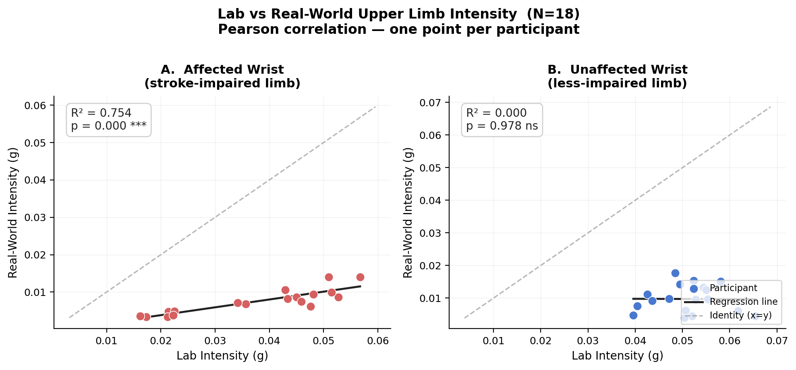

# Do Clinic Arm Assessments Reflect Arm Use at Home After Stroke?

Independent research project on wearable sensors and real-world arm use after stroke.

📄 **[Read the research report (PDF)](report/Research_Report.pdf)**

> **Privacy notice:** This repository contains **analysis code only**. No participant data,
> clinical scores, per-participant results, or figures made from study data are included.
> The data are protected health information and are not shared.
> A **synthetic data generator** is included so the full pipeline can be run and inspected.

---

## Research question

Clinicians judge upper-limb recovery from in-clinic assessments. But does how a stroke survivor
moves their arm **in the lab** reflect how much they actually use it **at home**?

## Study overview

- **Participants:** 18 chronic stroke survivors
- **Sensors:** bilateral wrist (and finger) accelerometers
- **Recordings:** a structured in-lab session, plus multi-day free-living home recordings
- **Clinical scores:** Fugl-Meyer Assessment (FMA), Motor Activity Log (MAL), Wolf Motor Function Test (WMFT)

## What I did

- Designed and led the study comparing lab-based and at-home arm activity measures.
- Built preprocessing pipelines that interpolate, align, and combine raw multi-sensor,
  multi-day recordings into epoch-level acceleration-magnitude data.
- Computed 7 sensor-based arm-use measures (intensity, use duration, and between-arm ratios).
- **Optimised an activity threshold** that removes rest/non-wear periods from home recordings,
  so lab and home intensities are comparable (paired t-test non-significant) while correlation stays strong.
- Tested lab–home agreement (Pearson correlation, R², paired t-tests) and related the sensor
  measures to clinical scores (Spearman correlation with FMA, MAL, WMFT).

## Key finding

Lab measures **predict home use for the stroke-affected arm** but **not for the unaffected arm**. In-clinic sensor assessments can be trusted as a proxy for real-world use of the
impaired arm. The less-affected arm behaves differently at home than in a structured clinic setting.

### Demo output (synthetic data, not study results)



*Generated by `tools/make_synthetic_data.py` + `run_all.py`. The synthetic generator is built to
mimic the qualitative pattern, so the numbers shown are **not** the study's results.*

---

## Repository structure

```
├── config.py                     # Paths, parameters, measure & clinical-score definitions
├── run_all.py                    # Runs analysis steps 01–04 in order
├── scripts/
│   ├── utils.py                  # Data loading, the 7 measures, inactive-epoch filtering
│   ├── 01_compute_measures.py    # 7 measures × lab/home for every participant
│   ├── 02_threshold_sweep.py     # Sweep 0.001–0.010 g activity thresholds (t-test + correlation)
│   ├── 03_lab_rw_correlations.py # Lab vs home agreement (main finding, Figure 1)
│   └── 04_clinical_correlations.py # Sensor measures vs FMA / MAL / WMFT (Figure 2)
├── preprocessing/
│   ├── in-lab/                   # Raw .dat sensor files -> interpolated, side-assigned epochs
│   └── real-world/               # Multi-day home recordings -> combined epoch-level data
├── tools/
│   └── make_synthetic_data.py    # Fake dataset with the same layout (no real data)
└── docs/                         # Demo figures from synthetic data
```

## Performance measures

| Measure | Description |
|---|---|
| Affected / unaffected intensity | Mean acceleration magnitude of each wrist |
| Bilateral intensity | Sum of both wrists' intensities |
| Intensity ratio | mean(log affected) − mean(log unaffected) |
| Affected / unaffected use duration | % of epochs above the activity threshold |
| Use ratio | log ratio of active-epoch counts between arms |

## Run it

```bash
pip install -r requirements.txt
python tools/make_synthetic_data.py   # writes a fake dataset to data/ (git-ignored)
python run_all.py                     # tables -> results/tables, figures -> results/figures
```

To run on your own data, point the pipeline at it without copying it into the repo:

```bash
export ARMUSE_DATA_DIR=/path/to/data   # expects in-lab/, real-world/, clinical_scores.csv
python run_all.py
```

`data/`, `results/`, and all `.csv`/`.dat` files are git-ignored so that participant data
cannot be committed by accident.

## Acknowledgements

Data were collected by the Advanced Human and Health Analytics (AHHA) Lab at UMass Amherst. The analysis, code,
and conclusions in this repository are my own.

## Tech

Python · NumPy · pandas · SciPy · Matplotlib · Jupyter
